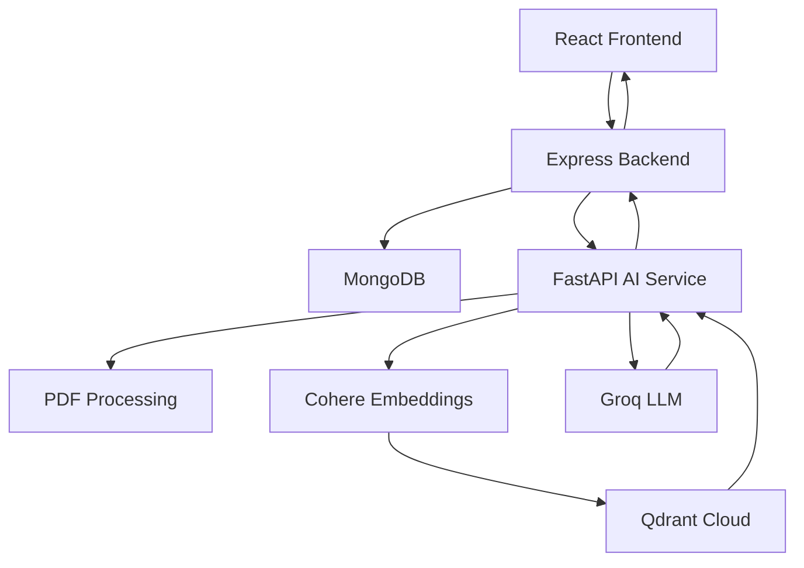

# BrandBeat — AI-Powered Brand Compliance Review Platform

BrandBeat is an AI-powered brand compliance platform that helps organizations evaluate documents against their internal brand guidelines and company policies.

It combines a React frontend, an Express backend, and a Python-based AI service to analyze uploaded documents, identify compliance issues, retrieve relevant policy information, and generate structured review results.

The platform is designed to support both automated AI analysis and human review, helping organizations maintain consistency, reduce manual effort, and improve compliance workflows.

---

## Table of Contents

- [Overview](#overview)
- [Key Features](#key-features)
- [System Architecture](#system-architecture)
- [Technology Stack](#technology-stack)
- [Project Structure](#project-structure)
- [How It Works](#how-it-works)
- [User Roles](#user-roles)
- [Installation and Setup](#installation-and-setup)
- [Environment Variables](#environment-variables)
- [Running the Application](#running-the-application)
- [API Services](#api-services)
- [AI Processing Pipeline](#ai-processing-pipeline)
- [Database and Vector Search](#database-and-vector-search)
- [Deployment](#deployment)
- [Security Considerations](#security-considerations)
- [Future Improvements](#future-improvements)
- [Contributing](#contributing)
- [License](#license)

---

## Overview

Organizations often rely on lengthy brand guidelines and internal policies to ensure that their documents, marketing materials, and communications follow established standards.

Manually checking every document against these guidelines can be time-consuming and inconsistent.

BrandBeat addresses this problem by providing an AI-assisted document compliance workflow.

Users can upload documents, select an active policy, and receive an AI-generated review containing findings, potential violations, and recommendations for human evaluation.

The platform uses Retrieval-Augmented Generation (RAG) to retrieve relevant policy information and provide context-aware compliance analysis.

## Key Features

### 1. Document Upload and Processing
- Upload PDF documents for compliance review.
- Extract text and document content using Python-based PDF processing.
- Process documents through the AI service.
- Generate reviewed document outputs.

### 2. AI-Powered Compliance Analysis
- Analyze documents against company policies.
- Use LLM-based reasoning to identify potential compliance issues.
- Generate structured findings.
- Categorize findings into violations and items requiring human review.
- Provide recommendations for addressing identified issues.

### 3. Policy Management
- Upload company policy documents.
- Extract policy content.
- Index policy information for semantic retrieval.
- Activate and archive policies.
- Maintain an active policy for reviewer workflows.

### 4. Retrieval-Augmented Generation (RAG)
- Generate embeddings from policy content.
- Store vector representations in Qdrant Cloud.
- Retrieve relevant policy context during document analysis.
- Provide policy-grounded AI responses.

### 5. Authentication and Authorization
- User authentication using JWT.
- Role-based access control.
- Separate administrator and reviewer permissions.
- Protected backend routes.

### 6. Human Review Workflow
- View detailed AI-generated review results.
- Inspect individual findings.
- Record human review decisions.
- Support final review decisions such as:
  - Pending
  - In Review
  - Changes Requested
  - Approved
  - Rejected

### 7. Review Management
- Store review records in MongoDB.
- Retrieve previous reviews.
- View review details and findings.
- Download generated review documents.

---

## System Architecture

BrandBeat follows a modular architecture that separates the frontend, backend API, and AI processing service.



### Architecture Responsibilities

| Component | Responsibility |
|---|---|
| React Frontend | User interface, dashboards, uploads, and review management |
| Express Backend | Authentication, authorization, business logic, and API orchestration |
| FastAPI Service | Document processing, embeddings, retrieval, and AI analysis |
| MongoDB | Users, policies, reviews, and application data |
| Qdrant Cloud | Vector storage and semantic retrieval |
| Cohere | Text embedding generation |
| Groq | LLM inference |

---

## Technology Stack

### Frontend
- React.js
- Vite
- JavaScript
- CSS / Tailwind CSS (where configured)
- Axios
- Redux Toolkit (where configured)

### Backend
- Node.js
- Express.js
- MongoDB
- Mongoose
- JSON Web Tokens (JWT)
- Cookie-based authentication
- Multer
- Helmet
- Morgan

### AI Service
- Python
- FastAPI
- LangChain
- LangChain Cohere
- LangChain Groq
- PyMuPDF
- Qdrant Client

### AI and Data Infrastructure
- Cohere Embeddings
- Groq LLM
- Qdrant Cloud
- MongoDB Atlas

### Development and Deployment
- Git and GitHub
- VS Code
- Vercel (frontend deployment)
- Render (backend and AI service deployment)

---

## Project Structure

```text
BrandBeat/
│
├── frontend/
│   ├── public/
│   ├── src/
│   │   ├── components/
│   │   ├── pages/
│   │   ├── services/
│   │   ├── features/
│   │   ├── hooks/
│   │   └── ...
│   ├── package.json
│   └── vite.config.js
│
├── backend/
│   ├── config/
│   ├── controllers/
│   ├── middleware/
│   ├── models/
│   ├── routes/
│   ├── services/
│   ├── utils/
│   ├── package.json
│   └── server.js
│
├── brandbeat-ai-service/
│   ├── main.py
│   ├── engine.py
│   ├── requirements.txt
│   ├── ...
│   └── .env.example
│
├── .gitignore
└── README.md
```

*The directory names above describe the intended organization. Adjust individual subdirectories or entry-point filenames to match the actual repository.*

---

## How It Works

The main compliance workflow follows these steps:

1. **Authentication:** A user signs in and receives access to the platform according to their assigned role.
2. **Policy Setup:** An administrator uploads a company policy PDF.
3. **Policy Extraction:** The AI service extracts relevant text from the policy document.
4. **Embedding Generation:** Policy content is converted into vector embeddings using Cohere.
5. **Vector Indexing:** Embeddings are stored in Qdrant Cloud.
6. **Document Upload:** A reviewer uploads a document for compliance analysis.
7. **Context Retrieval:** The AI service retrieves relevant policy sections from Qdrant.
8. **AI Analysis:** Groq LLM analyzes the uploaded document using the retrieved policy context.
9. **Finding Generation:** The service generates structured compliance findings and recommendations.
10. **Review Storage:** The Express backend stores the review results in MongoDB.
11. **Human Decision:** An administrator can inspect findings and make a final review decision.

---

## User Roles

### Administrator

Administrators manage the policy library and oversee compliance reviews.

Responsibilities include:
- Uploading policies.
- Activating and archiving policies.
- Viewing all policies.
- Managing compliance review decisions.
- Approving or rejecting completed reviews.

### Reviewer

Reviewers use active company policies to conduct document reviews.

Responsibilities include:
- Viewing active policies.
- Uploading documents for review.
- Viewing AI-generated findings.
- Inspecting review reports.

Backend authorization is used to enforce role-based access rather than relying only on frontend visibility.

---

## Installation and Setup

### Prerequisites

Install the following before running the project:

- Node.js and npm
- Python 3.11 or a compatible version for the pinned dependencies
- MongoDB database or MongoDB Atlas account
- Qdrant Cloud account
- Cohere API key
- Groq API key
- Git

### 1. Clone the Repository

```bash
git clone https://github.com/YOUR_USERNAME/BrandBeat.git

cd BrandBeat
```

### 2. Configure the Frontend

```bash
cd frontend

npm install
```

Create a `.env` file inside the `frontend` directory:

```env
VITE_API_URL=http://localhost:5000/api
```

### 3. Configure the Express Backend

```bash
cd ../backend

npm install
```

Create a `.env` file inside the `backend` directory.

Example configuration:

```env
PORT=5000
NODE_ENV=development

MONGODB_URI=your_mongodb_connection_string

JWT_ACCESS_SECRET=your_access_secret
JWT_REFRESH_SECRET=your_refresh_secret

AI_SERVICE_URL=http://127.0.0.1:8000
AI_SERVICE_TOKEN=your_shared_ai_service_token

CLIENT_URL=http://localhost:5173
```

Use the exact variable names expected by your backend configuration.

### 4. Configure the Python AI Service

```bash
cd ../brandbeat-ai-service

python -m venv .venv
```

Activate the virtual environment.

**Windows PowerShell:**

```powershell
.\.venv\Scripts\Activate.ps1
```

**Linux / macOS:**

```bash
source .venv/bin/activate
```

Install Python dependencies:

```bash
python -m pip install -r requirements.txt
```

Create a `.env` file inside `brandbeat-ai-service`:

```env
GROQ_API_KEY=your_groq_api_key
COHERE_API_KEY=your_cohere_api_key

QDRANT_URL=your_qdrant_cloud_url
QDRANT_API_KEY=your_qdrant_api_key

AI_SERVICE_TOKEN=your_shared_ai_service_token
```

Ensure the token shared between Express and FastAPI is identical.

Use the actual variable names defined in your service configuration.

---

## Running the Application

Run each service in a separate terminal.

### Terminal 1 — FastAPI AI Service

```bash
cd brandbeat-ai-service

# Activate virtual environment first

python -m uvicorn main:app --reload --host 127.0.0.1 --port 8000
```

FastAPI documentation:

```text
http://127.0.0.1:8000/docs
```

Health check:

```text
http://127.0.0.1:8000/api/v1/health
```

### Terminal 2 — Express Backend

```bash
cd backend

npm run dev
```

Use the actual development script defined in `backend/package.json`.

### Terminal 3 — React Frontend

```bash
cd frontend

npm run dev
```

Open:

```text
http://localhost:5173
```

---

## API Services

BrandBeat uses two separate API layers.

### Express Backend

The Express backend handles:
- User authentication.
- User authorization.
- Policy management.
- Review management.
- Communication with the AI service.
- Persistence of application data.

### FastAPI AI Service

The Python service handles:
- PDF text extraction.
- Policy document processing.
- Policy indexing.
- Vector retrieval.
- AI-powered compliance analysis.
- Reviewed document generation.

The exact API endpoints and request schemas are maintained in the respective service implementations.

---

## AI Processing Pipeline

BrandBeat uses a Retrieval-Augmented Generation architecture to ground AI analysis in company policy documents.

### Step 1: Policy Ingestion

The policy PDF is uploaded and its text is extracted.

### Step 2: Text Processing

Extracted text is prepared and divided into smaller chunks suitable for embedding and retrieval.

### Step 3: Embedding Generation

Cohere generates vector embeddings representing the policy content.

### Step 4: Vector Storage

The generated embeddings and associated policy information are stored in Qdrant Cloud.

### Step 5: Query and Retrieval

When a document is submitted for review, relevant policy information is retrieved through semantic similarity search.

### Step 6: LLM Analysis

Groq provides LLM inference using the document content and retrieved policy context.

### Step 7: Structured Output

The AI service returns structured compliance findings for the Express backend to store and display.

---

## Database and Vector Search

### MongoDB

MongoDB is used for persistent application data, including:

- User accounts and roles.
- Uploaded policy metadata.
- Compliance review records.
- Review findings.
- Human review decisions.

### Qdrant Cloud

Qdrant is used as the vector database for storing policy embeddings.

It enables semantic retrieval of relevant policy information during document analysis.

### Why Use Both?

MongoDB and Qdrant serve different purposes:

| MongoDB | Qdrant |
|---|---|
| Stores application records | Stores vector embeddings |
| Stores users and roles | Supports semantic search |
| Stores review metadata | Retrieves relevant policy context |
| Stores policy metadata | Supports RAG workflows |

---

## Deployment

BrandBeat is structured as a monorepo and can be deployed as three independent services.

| Service | Platform | Root Directory |
|---|---|---|
| Frontend | Vercel | `frontend` |
| Express Backend | Render | `backend` |
| FastAPI AI Service | Render | `brandbeat-ai-service` |

### Frontend — Vercel

Build command:

```bash
npm run build
```

Output directory:

```text
dist
```

Environment variable:

```env
VITE_API_URL=https://your-express-service.onrender.com/api
```

### Express Backend — Render

Build command:

```bash
npm install
```

Start command:

```bash
npm start
```

Use the start script defined in `backend/package.json`.

Configure MongoDB, JWT, AI service URL, AI service token, and production CORS settings.

### FastAPI AI Service — Render

Build command:

```bash
pip install -r requirements.txt
```

Start command:

```bash
uvicorn main:app --host 0.0.0.0 --port $PORT
```

Configure the required Cohere, Groq, Qdrant, and service authentication environment variables.

### Production Considerations

- Use MongoDB Atlas for managed database hosting.
- Keep API credentials in platform environment variables.
- Configure CORS for the deployed frontend origin.
- Configure cross-origin cookie authentication correctly if frontend and backend use different domains.
- Use persistent or external object storage for uploaded PDFs and generated documents. Render's ordinary filesystem should not be treated as permanent storage.
- Configure health checks for the deployed services.

---

## Security Considerations

BrandBeat uses several security practices:

- JWT-based authentication.
- Role-based authorization.
- Protected API routes.
- Environment-based secret management.
- Server-side authorization checks.
- Separate authentication between Express and FastAPI.
- Input and file-upload validation.

**Never commit the following to GitHub:**

- `.env` files containing real credentials.
- JWT secrets.
- MongoDB connection strings.
- Cohere or Groq API keys.
- Qdrant API keys.
- Private service authentication tokens.

Use `.env.example` files containing placeholders to document required configuration.

---

## Future Improvements

Potential areas for further development include:

- More advanced document-format support.
- Improved document-level and page-level compliance explanations.
- More detailed policy traceability for each finding.
- Enhanced review analytics and dashboards.
- Notifications for review status changes.
- Document version comparison.
- Audit logs and activity tracking.
- Scalable document storage.
- Automated testing and CI/CD pipelines.

---

## Contributing

Contributions, suggestions, and bug reports are welcome.

To contribute:

1. Fork the repository.
2. Create a feature branch.

```bash
git checkout -b feature/your-feature-name
```

3. Commit your changes.

```bash
git commit -m "Add: your feature description"
```

4. Push the branch.

```bash
git push origin feature/your-feature-name
```

5. Open a Pull Request.

---

## License

This project is currently distributed without an explicitly specified open-source license.

Add a license file before allowing others to reuse, modify, or redistribute the project.

---

## Project

**BrandBeat — AI-Powered Brand Compliance Review Platform**

Built with React, Node.js, FastAPI, LangChain, Cohere, Groq, MongoDB, and Qdrant.

